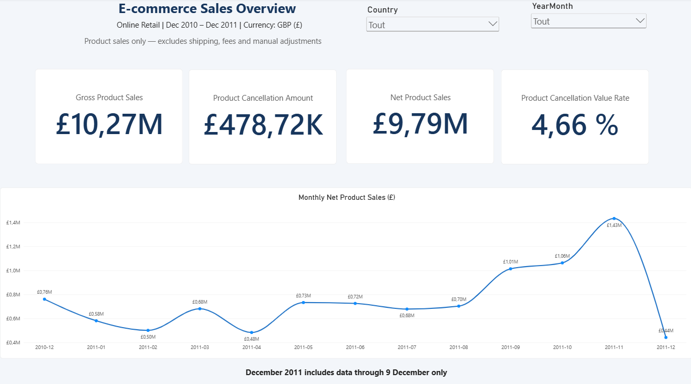
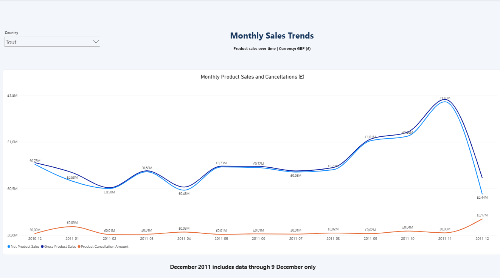
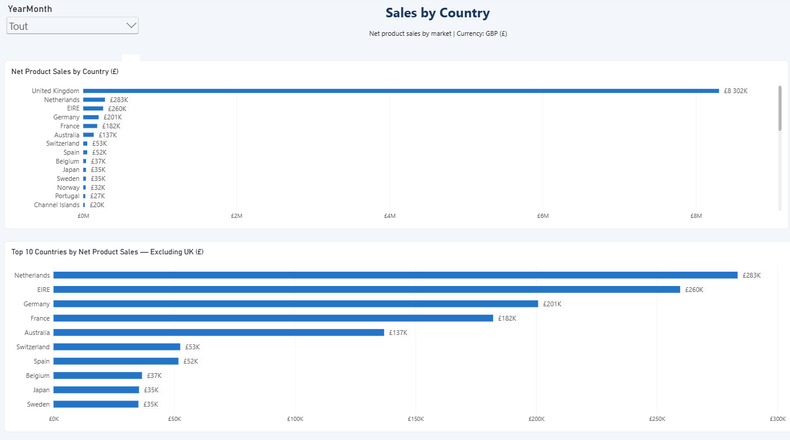
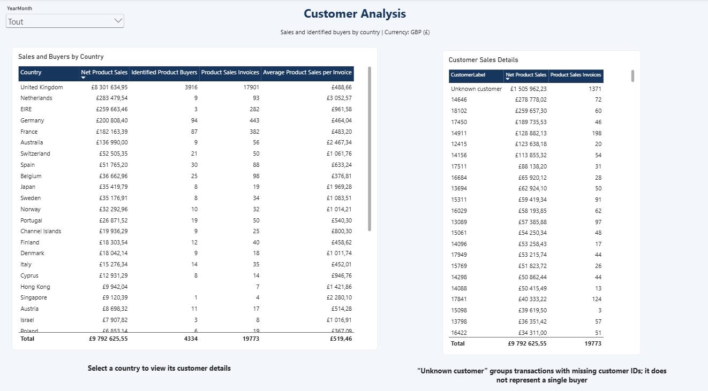
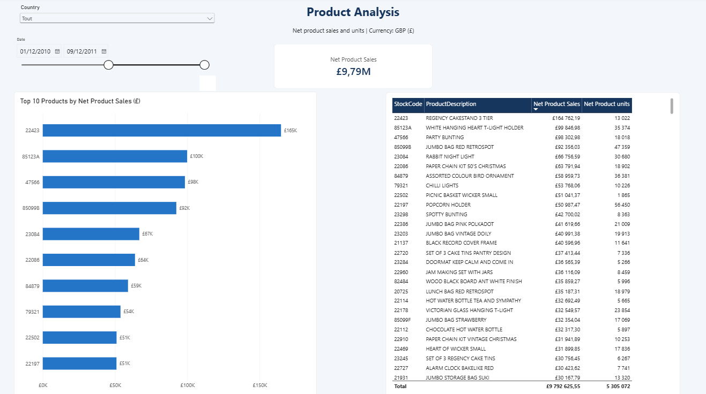
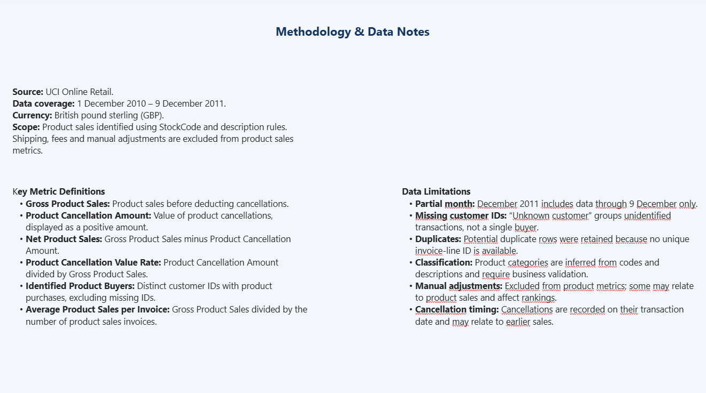
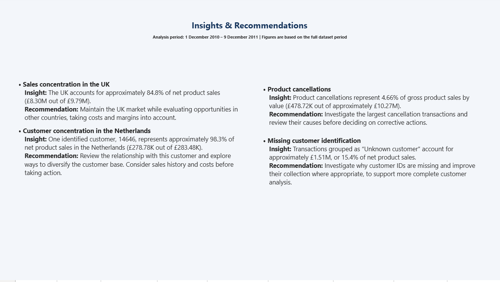

# E-commerce Sales Analysis | Power BI

Power BI project analysing online retail sales, cancellations, geographic markets, customers, and product performance.

Built with Power Query, a star schema, and DAX measures, the report turns transaction data into business insights while documenting data quality issues and analytical limitations.

## Dashboard Preview

## Business Questions

- How much product sales value remains after cancellations?
- How do sales and cancellations evolve over time?
- Which countries contribute the most to net product sales?
- Are sales concentrated among a small number of customers?
- Which products generate the highest net sales?
- How do missing customer IDs affect customer analysis?

## Dataset

- **Source:** [UCI Machine Learning Repository — Online Retail](https://archive.ics.uci.edu/dataset/352/online+retail)
- **Period:** 1 December 2010 to 9 December 2011
- **Source rows:** 541,909
- **Currency:** British pound sterling (GBP)
- **Granularity:** One transaction line for an item within an invoice

December 2011 is incomplete and should not be compared directly with full months.

## Tools and Skills

- **Power BI Desktop:** Interactive report design
- **Power Query / M:** Data profiling, transformation, and audit queries
- **Data modelling:** Star schema and one-to-many relationships
- **DAX:** Sales, cancellation, customer, invoice, and quantity measures
- **Business analysis:** Findings, recommendations, and limitations

## Data Preparation and Quality Checks

The preparation process focused on understanding unusual records before deciding how to use them.

- Assigned appropriate data types, including fixed decimal types for monetary fields.
- Standardised product codes to support consistent relationships.
- Created transaction status fields to distinguish sales, cancellations, and records requiring review.
- Classified item codes to separate product candidates from shipping, fees, vouchers, and manual adjustments.
- Created audit queries to inspect potential duplicates, missing descriptions, unusual quantities, prices, and cancellations.
- Retained potential duplicate rows because the source does not provide a unique invoice-line identifier.
- Preserved transactions with missing customer IDs using an `UNKNOWN` customer key.
- Created a product dimension with one representative description per product code.
- Created a calendar table for chronological analysis.

Item classifications are inferred from codes and descriptions and require business validation.

## Data Model

The model uses a central transaction fact table and four dimensions:

| Table | Purpose |
|---|---|
| FactTransactions | Transaction quantities, prices, amounts, and classification fields |
| DimDate | Calendar attributes for time analysis |
| DimCountry | Country filtering and geographic analysis |
| DimCustomer | Customer keys and display labels |
| DimProduct | Product codes and representative descriptions |

The dimensions filter the fact table through one-to-many relationships.

Staging and audit queries support preparation and validation without being loaded as report tables.

## Key Metrics

| Metric | Definition |
|---|---|
| Gross Product Sales | Product sales value before deducting cancellations |
| Product Cancellation Amount | Product cancellation value, displayed as a positive amount |
| Net Product Sales | Gross Product Sales minus Product Cancellation Amount |
| Product Cancellation Value Rate | Product Cancellation Amount divided by Gross Product Sales |
| Product Sales Invoices | Distinct invoices containing qualifying product sales |
| Identified Product Buyers | Distinct identified customers with qualifying product purchases |
| Average Product Sales per Invoice | Gross Product Sales divided by Product Sales Invoices |
| Net Product Units | Product units sold minus cancelled product units |

Product measures exclude non-product items and manual adjustments according to the classification rules.

## Overall Results

Figures below cover the full dataset period.

| Metric | Result |
|---|---:|
| Gross Product Sales | Approximately £10.27M |
| Product Cancellation Amount | Approximately £478.72K |
| Net Product Sales | £9,792,625.55 |
| Product Cancellation Value Rate | 4.66% |
| Product Sales Invoices | 19,773 |
| Identified Product Buyers | 4,334 |
| Average Product Sales per Invoice | £519.46 |
| Net Product Units | 5,305,072 |

## Main Findings and Recommendations

### 1. Sales are concentrated in the UK

The UK contributes approximately **84.8% of net product sales**, or £8.30M out of £9.79M.

**Recommendation:** Maintain the UK market while evaluating opportunities in other countries, considering costs and margins.

### 2. The Netherlands relies heavily on one identified customer

Customer **14646** contributes approximately **98.3% of net product sales in the Netherlands**.

**Recommendation:** Review this customer relationship and explore opportunities to diversify the customer base.

### 3. Cancellations represent a measurable loss of sales value

Product cancellations account for **4.66% of gross product sales by value**.

**Recommendation:** Investigate the largest cancellations and their causes before deciding on corrective actions.

### 4. Missing customer IDs limit customer analysis

Transactions grouped under **Unknown customer** represent approximately **£1.51M**, or **15.4% of net product sales**.

**Recommendation:** Investigate why customer IDs are missing and improve their collection where appropriate.

## Report Pages

### Sales Trends

Monthly comparison of gross sales, net sales, and cancellation amounts.

### Country Analysis

Country ranking and a separate view of the top 10 markets excluding the UK.

### Customer Analysis

Country-level customer metrics and customer details.

### Product Analysis

Top 10 products by net sales and detailed product sales and quantities.

### Methodology and Data Notes

Metric definitions, preparation decisions, and analytical limitations.

### Insights and Recommendations

Business findings and suggested actions.

## Important Limitations

- December 2011 contains data through 9 December only.
- `Unknown customer` groups unidentified transactions; it does not represent a single buyer.
- Potential duplicates were retained because repeated lines cannot be confirmed as errors.
- Item classifications are inferred rather than validated against an official business mapping.
- Excluded manual adjustments may relate to product transactions and affect product rankings.
- Cancellations are analysed on their recorded transaction dates and may relate to earlier sales.
- The cancellation value rate is not a percentage of orders cancelled.
- No cost data is available, so sales performance should not be interpreted as profitability.

## How to Explore the Report

1. Download the `.pbix` file from this repository.
2. Open it in Power BI Desktop.
3. Use the available country and date filters to explore the report.
4. Select a country in the Customer Analysis table to inspect its customer details.

To refresh the data, download the source dataset and update the source file path in Power Query to match your local location.

## Author

**Nour El Houda Ben Slimen**

Business Intelligence | Power BI | Data Analysis
